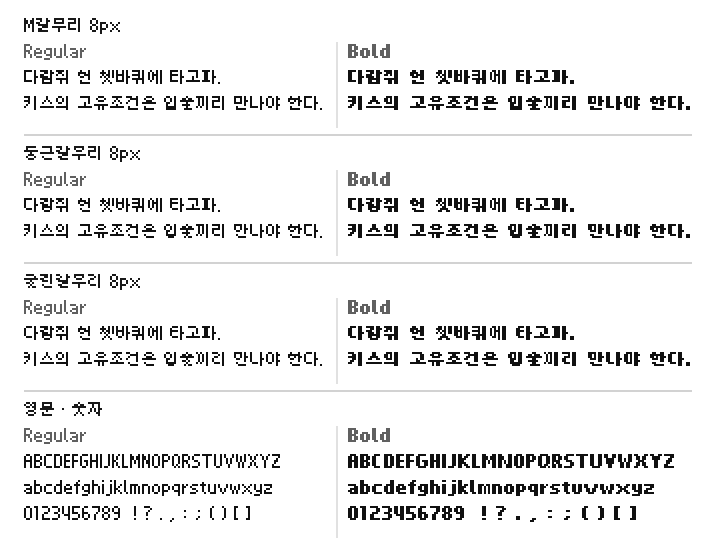
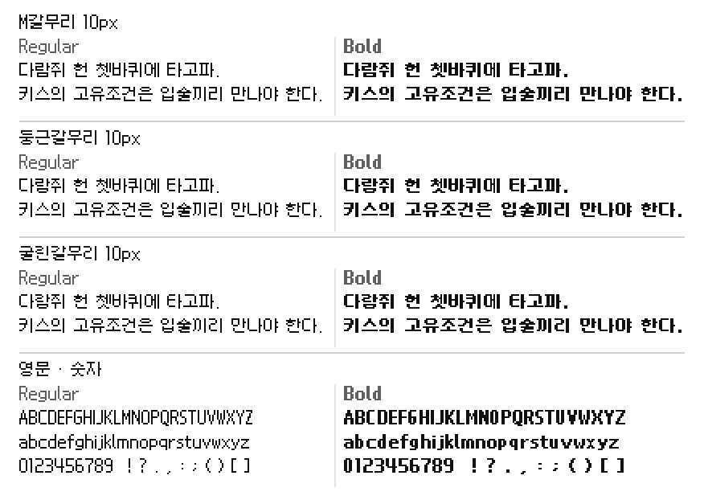
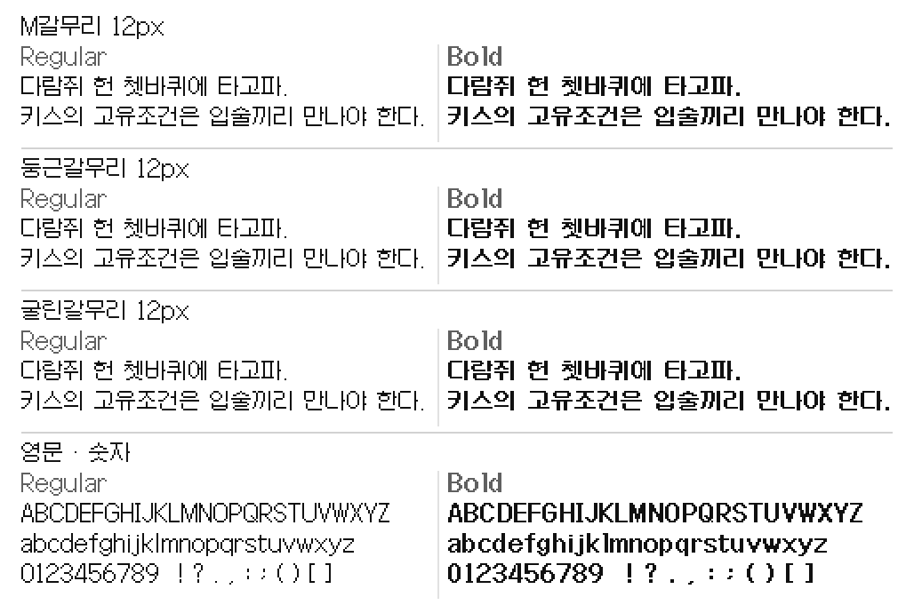
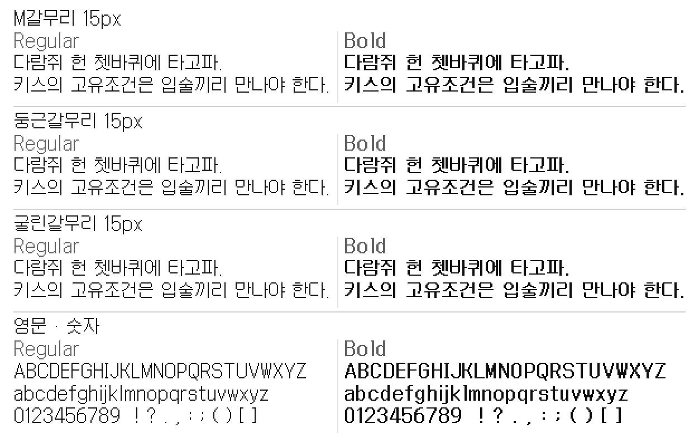
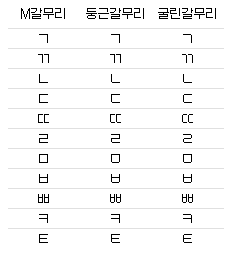
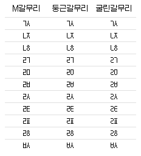

# M갈무리

갈무리(Galmuri)를 바탕으로 Monad ABXY가 수정한 픽셀 폰트입니다.
M갈무리, 둥근갈무리, 굴린갈무리의 8·10·12·15px를 Regular와 Bold 굵기로 제공합니다.

## 폰트 미리보기

[사용해 보기](https://monadabxy.com/fonts/mgalmuri/)

### 8px



### 10px



### 12px



### 15px



## 자음 형태 비교

| 종류 | 형태 |
| --- | --- |
| M갈무리 | 기본 자음 형태 |
| 둥근갈무리 | 아래쪽 모서리를 꺾은 형태 |
| 굴린갈무리 | 위쪽 모서리와 내부 꺾임까지 다듬은 형태 |

### 자음



### 겹받침



## 다운로드

[최신 버전 다운로드](https://github.com/MonadABXY/mgalmuri-font/releases/latest)

## 웹폰트 적용

HTML `<link>` 태그 또는 CSS `@import` 방식으로 폰트를 불러온 후 사용할 수 있습니다.

### `<link>`

```html
<link rel="stylesheet" href="https://cdn.jsdelivr.net/gh/MonadABXY/mgalmuri-font@main/web/mgalmuri.css" />
```

### `@import`

```css
@import url("https://cdn.jsdelivr.net/gh/MonadABXY/mgalmuri-font@main/web/mgalmuri.css");
```

### 폰트 패밀리로 사용

```css
/* 기본 (Regular) */
font-family: "MGalmuri12", sans-serif;
font-weight: 400;

/* 볼드 (Bold) */
font-family: "MGalmuri12", sans-serif;
font-weight: 700;
```

### 클래스로 사용

```html
<div class="mgalmuri12">M갈무리 12px</div>
<div class="mgalmuri12-bold">M갈무리 12px Bold</div>
```

## 종류와 권장 크기

각 폰트는 **Regular (400)** 및 **Bold (700)** 굵기를 제공합니다.

| px | M갈무리 | 둥근갈무리 | 굴린갈무리 | 굵기 | pt |
| --- | --- | --- | --- | --- | --- |
| 8px | `MGalmuri8` | `DungeunGalmuri8` | `GullinGalmuri8` | Regular, Bold | 6pt |
| 10px | `MGalmuri10` | `DungeunGalmuri10` | `GullinGalmuri10` | Regular, Bold | 7.5pt |
| 12px | `MGalmuri12` | `DungeunGalmuri12` | `GullinGalmuri12` | Regular, Bold | 9pt |
| 15px | `MGalmuri15` | `DungeunGalmuri15` | `GullinGalmuri15` | Regular, Bold | 11.25pt |

기본 픽셀 크기 또는 정수 배율을 권장합니다.

## 지원 문자

모든 크기에 현대 한글 완성형 11,172자가 들어 있습니다.
그 밖의 문자 지원은 크기에 따라 다릅니다.

[크기별 지원 문자와 OpenType 기능](docs/GLYPHS.md)을 참고하세요.

## 라이선스와 출처

[SIL 오픈 폰트 라이선스 1.1](OFL.txt)로 배포합니다.

원본 갈무리의 저작자는 [Lee Minseo (quiple)](https://quiple.dev/font/galmuri)입니다.
